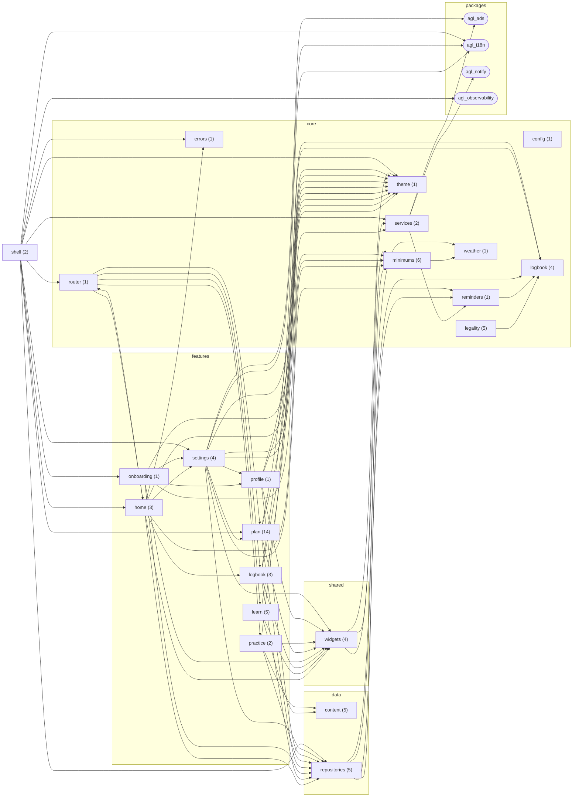

# PilotEnRoute — architecture

Notes written here, outside the generated blocks, are kept.

<!-- architecture:start (generated by manifest/scripts/app_architecture.py; do not edit) -->

Read this before opening code: it says which file holds what, so only that file needs
reading. Product rules are in [`SPEC.md`](SPEC.md), screens and tokens in
[`design/`](design/README.md), ads and vendor keys in [`INTEGRATIONS.md`](INTEGRATIONS.md).

## Size

`lib/`: 72 Dart files, 22,907 lines, about 204,300 tokens to read in full.
This map: about 3,000 tokens.

## Modules

Each box is a folder of `lib/` (file count in brackets); an arrow means the first imports
the second. `shell` is `lib/` itself (`main.dart`, `app.dart`).

Imported by most modules, so arrows into them are left out: `core/legality`.



## Files

| File (in `lib/`) | Lines | Public declarations |
| --- | --- | --- |
| `app.dart` | 188 | PilotEnRouteApp, RootGate |
| `core/config/app_env.dart` | 31 | Environment, AppEnv |
| `core/errors/error_reporter.dart` | 113 | ErrorSink, ErrorReporter |
| `core/legality/calendar.dart` | 37 | dateOnly, endOfMonthAfter, startOfMonthAfter, daysBetween, addDays, monthsBetween |
| `core/legality/date_text.dart` | 32 | dayMonthYear, dayMonth, monthYear, isoDate, zuluTime |
| `core/legality/legality_engine.dart` | 904 | PlannedFlight, RuleId, RuleState, RuleStatus, LegalityReport, LegalityEngine, medicalValidThrough |
| `core/legality/pilot_profile.dart` | 183 | MedicalKind, MedicalPrivilege, PilotProfile |
| `core/legality/private_pilot_progress.dart` | 288 | ProgressUnit, ProgressItem, PrivatePilotProgress, privatePilotProgress |
| `core/logbook/entry_validation.dart` | 74 | Parsed, parseHours, parseCount, crossCheck |
| `core/logbook/logbook_csv.dart` | 366 | CsvImportError, CsvImportResult, csvField, csvRow, logbookToCsv, parseCsvRecords, logbookFromCsv, csvHeader |
| `core/logbook/logbook_entry.dart` | 298 | CategoryClass, LogbookEntry |
| `core/logbook/logbook_query.dart` | 223 | LogbookQuery, MonthGroup, LogbookTotals, filterEntries, groupByMonth, totalsWithin |
| `core/minimums/go_check.dart` | 240 | FetchStatus, WeatherSnapshot, GoVerdict, GoResult, evaluateGo |
| `core/minimums/go_record.dart` | 147 | GoCheckRecord, filterChecks |
| `core/minimums/minimums_check.dart` | 254 | CheckState, MinimumLine, MinimumsResult, checkAgainst |
| `core/minimums/personal_minimums.dart` | 74 | MinimumsSet, PersonalMinimums |
| `core/minimums/runway_wind.dart` | 118 | RunwayWind, bestRunway |
| `core/minimums/solar.dart` | 173 | SunTimes, NightWindow, sunTimes, nightCurrencyWindow, nightWindowForDeparture, nightWindowLine, kMaxSolarLatitude |
| `core/reminders/reminder_plan.dart` | 161 | ReminderKind, LapseItem, PlannedReminder, reminderId, lapseItemsFrom, planReminders, reminderLeadDays |
| `core/router/app_shell.dart` | 85 | AppShell, AppShellState |
| `core/services/ad_service.dart` | 276 | AdUnitIds, AdService |
| `core/services/notification_service.dart` | 195 | NotificationService, ReminderSyncResult |
| `core/theme/theme.dart` | 576 | Sky, AppFonts, AppType, PanelTheme, Rbf, buildSkyTheme, buildRbfTheme, skyLightScheme, skyDarkScheme |
| `core/weather/awc_models.dart` | 470 | Visibility, CloudLayer, Wind, MetarObservation, TafGroup, TafReport, RunwayInfo, RunwayEnd, AirportReference, ceilingFrom |
| `data/content/faa_library.g.dart` | 75 | faaLibrary |
| `data/content/faa_questions.g.dart` | 449 | faaQuestionsSourceNote, faaSampleQuestions |
| `data/content/instruments.g.dart` | 171 | instrumentSources, instrumentLessons, trafficPattern, airportSigns, airportMarkings |
| `data/content/knowledge_question.dart` | 64 | KnowledgeQuestion |
| `data/content/sourced.dart` | 75 | SourcedLine, SourceDoc, InstrumentLesson, AirportSign, LibraryBook, LibraryChapter |
| `data/repositories/logbook_service.dart` | 400 | LogbookService |
| `data/repositories/logbook_store.dart` | 208 | LogbookStore, MemoryLogbookStore, SqfliteLogbookStore, createV1Schema, openLogbookDatabase, logbookSchemaVersion, v2Columns |
| `data/repositories/practice_store.dart` | 153 | PracticeAnswer, TopicScore, PracticeStore |
| `data/repositories/settings_store.dart` | 116 | SettingsStore |
| `data/repositories/weather_service.dart` | 302 | AwcAnswer, WeatherService, flightCategoryColor, awcBase |
| `features/home/presentation/go_history_screen.dart` | 196 | GoHistoryScreen |
| `features/home/presentation/home_screen.dart` | 197 | HomeScreen |
| `features/home/presentation/today_screen.dart` | 959 | TodayScreen |
| `features/learn/presentation/airport_ops_screen.dart` | 252 | AirportOpsScreen, PatternPainter |
| `features/learn/presentation/instruments.dart` | 303 | AttitudeIndicatorPainter, AsiPainter, AltimeterPainter, VsiPainter, HeadingPainter, TurnCoordinatorPainter |
| `features/learn/presentation/learn_screen.dart` | 87 | LearnScreen |
| `features/learn/presentation/library_screen.dart` | 125 | LibraryScreen |
| `features/learn/presentation/six_pack_screen.dart` | 276 | SixPackScreen |
| `features/logbook/presentation/logbook_entry_screen.dart` | 479 | LogbookEntryScreen, LogbookEntryScreenState |
| `features/logbook/presentation/logbook_screen.dart` | 773 | LogbookScreen |
| `features/logbook/presentation/student_progress_screen.dart` | 142 | StudentProgressScreen |
| `features/onboarding/presentation/onboarding_screen.dart` | 312 | OnboardingScreen |
| `features/plan/data/chart_service.dart` | 125 | ChartService, dtppCycleFor, dtppSearchUri, kDtppCycleAnchor, kDtppCycleDays |
| `features/plan/data/document_service.dart` | 542 | DocCategory, PilotDocument, DocumentService |
| `features/plan/data/flight_plan_service.dart` | 314 | Waypoint, FlightPlan, NavLogLeg, FlightPlanService |
| `features/plan/data/weight_balance_service.dart` | 427 | WBStation, WBEnvelopePoint, AircraftProfile, WBResult, WeightBalanceService, kFuelWeightPerGallon |
| `features/plan/presentation/airport_screen.dart` | 256 | AirportScreen |
| `features/plan/presentation/charts_screen.dart` | 241 | ChartsScreen |
| `features/plan/presentation/checklist_screen.dart` | 1102 | ChecklistScreen |
| `features/plan/presentation/documents_screen.dart` | 1002 | DocumentsScreen |
| `features/plan/presentation/e6b_screen.dart` | 1230 | E6BScreen |
| `features/plan/presentation/flight_plan_screen.dart` | 519 | FlightPlanScreen |
| `features/plan/presentation/fuel_screen.dart` | 974 | FuelScreen |
| `features/plan/presentation/plan_screen.dart` | 217 | PlanScreen |
| `features/plan/presentation/weather_screen.dart` | 506 | WeatherScreen |
| `features/plan/presentation/weight_balance_screen.dart` | 1147 | WeightBalanceScreen |
| `features/practice/presentation/practice_screen.dart` | 149 | PracticeScreen |
| `features/practice/presentation/quiz_screen.dart` | 274 | QuizScreen |
| `features/profile/presentation/profile_screen.dart` | 292 | ProfileScreen, AircraftClassPicker, MedicalForm |
| `features/settings/data/reminder_service.dart` | 155 | ReminderService |
| `features/settings/presentation/minimums_screen.dart` | 193 | MinimumsScreen, MinimumsForm, MinimumsFormState |
| `features/settings/presentation/reminders_screen.dart` | 115 | RemindersScreen |
| `features/settings/presentation/settings_screen.dart` | 234 | SettingsScreen, AboutPilotEnRouteScreen |
| `main.dart` | 53 | main |
| `shared/widgets/ad_banner_widget.dart` | 157 | AdBannerWidget |
| `shared/widgets/sky_scene.dart` | 383 | SkyMood, SkyScene, SkyScenePainter |
| `shared/widgets/status_tag.dart` | 152 | Tone, StatusLook, StatusTag, toneColor, toneSoft, lookForRule, lookForCheck, lookForVerdict |
| `shared/widgets/widgets.dart` | 528 | SectionHeader, PageTitle, MonoBlock, SkyCard, PlacardCard, IconTile, NavRowCard, StatTile, ProgressStrip, SegmentedTabBar +1 |

## Dependencies

- Shared (`manifest/packages/`): `agl_ads`, `agl_i18n`, `agl_notify`, `agl_observability`
- pub.dev: `cupertino_icons`, `flutter_local_notifications`, `google_mobile_ads`, `http`, `image_picker`, `intl`, `path`, `path_provider`, `pdf`, `printing`, `provider`, `shared_preferences`, `sqflite`, `timezone`, `url_launcher`

## Tests

46 files in `test/`, 2 in `integration_test/`.

## Whole-app context for a chat

An agent with file access should read this map and then single files. To paste the
whole app into a chat that cannot read files (outlines only, about a fifth of the size):

```bash
repomix apps/PilotEnRoute --include "lib/**,test/**" --compress -o /tmp/PilotEnRoute.xml
```

<!-- architecture:end -->

<!-- hotspots:start (generated by manifest/scripts/app_architecture.py; do not edit) -->

## Hotspots

Files changed most often (commits since each file got its current path; the 2026-10-17
restructure is not counted). Read these with care and test them first.

| File | Commits | Lines |
| --- | --- | --- |
| `lib/main.dart` | 20 | 53 |
| `lib/core/logbook/logbook_csv.dart` | 2 | 366 |

<!-- hotspots:end -->
