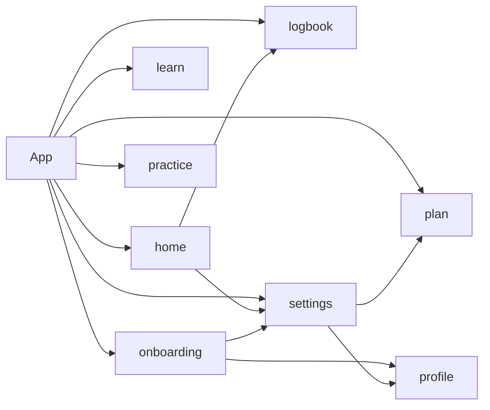

# PilotEnRoute — design

Notes written here, outside the generated block, are kept.

<!-- design:start (generated by manifest/scripts/app_design.py; do not edit) -->

## Screen map

Which module opens or uses which, measured from the code's imports (`App` is the
shell: `lib/` outside `features/`). It is the app as built, not a designed flow:
draw intended flows in `flows/`.

## Screens

| Module | Screen | File |
| --- | --- | --- |
| `home` | GoHistoryScreen | `lib/features/home/presentation/go_history_screen.dart` |
| `home` | HomeScreen | `lib/features/home/presentation/home_screen.dart` |
| `home` | TodayScreen | `lib/features/home/presentation/today_screen.dart` |
| `learn` | AirportOpsScreen | `lib/features/learn/presentation/airport_ops_screen.dart` |
| `learn` | LearnScreen | `lib/features/learn/presentation/learn_screen.dart` |
| `learn` | LibraryScreen | `lib/features/learn/presentation/library_screen.dart` |
| `learn` | SixPackScreen | `lib/features/learn/presentation/six_pack_screen.dart` |
| `logbook` | LogbookEntryScreen | `lib/features/logbook/presentation/logbook_entry_screen.dart` |
| `logbook` | LogbookScreen | `lib/features/logbook/presentation/logbook_screen.dart` |
| `logbook` | StudentProgressScreen | `lib/features/logbook/presentation/student_progress_screen.dart` |
| `onboarding` | OnboardingScreen | `lib/features/onboarding/presentation/onboarding_screen.dart` |
| `plan` | AirportScreen | `lib/features/plan/presentation/airport_screen.dart` |
| `plan` | ChartsScreen | `lib/features/plan/presentation/charts_screen.dart` |
| `plan` | ChecklistScreen | `lib/features/plan/presentation/checklist_screen.dart` |
| `plan` | DocumentsScreen | `lib/features/plan/presentation/documents_screen.dart` |
| `plan` | E6BScreen | `lib/features/plan/presentation/e6b_screen.dart` |
| `plan` | FlightPlanScreen | `lib/features/plan/presentation/flight_plan_screen.dart` |
| `plan` | FuelScreen | `lib/features/plan/presentation/fuel_screen.dart` |
| `plan` | PlanScreen | `lib/features/plan/presentation/plan_screen.dart` |
| `plan` | WeatherScreen | `lib/features/plan/presentation/weather_screen.dart` |
| `plan` | WeightBalanceScreen | `lib/features/plan/presentation/weight_balance_screen.dart` |
| `practice` | PracticeScreen | `lib/features/practice/presentation/practice_screen.dart` |
| `practice` | QuizScreen | `lib/features/practice/presentation/quiz_screen.dart` |
| `profile` | ProfileScreen | `lib/features/profile/presentation/profile_screen.dart` |
| `settings` | MinimumsScreen | `lib/features/settings/presentation/minimums_screen.dart` |
| `settings` | RemindersScreen | `lib/features/settings/presentation/reminders_screen.dart` |
| `settings` | SettingsScreen | `lib/features/settings/presentation/settings_screen.dart` |
| `settings` | AboutPilotEnRouteScreen | `lib/features/settings/presentation/settings_screen.dart` |

## Current screenshots

Committed 2026-10-16. They can predate the current build: re-capture with `integration_test/store_screenshots_test.dart` before a release.

     

## Design tokens

[`tokens.json`](tokens.json): colours and fonts from `lib/core/theme/`.
Next-release mockups go in [`screens/`](screens/), intended flows in [`flows/`](flows/).

<!-- design:end -->
